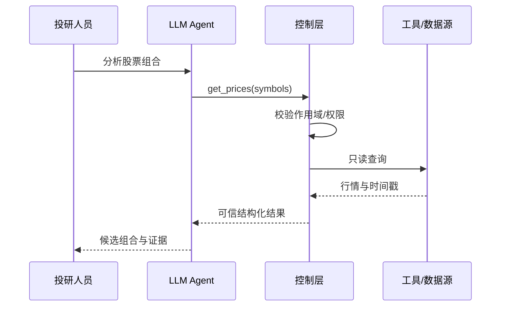
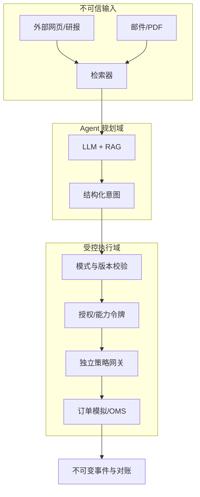

# 第一篇：金融 Agent 基础

**本篇主线：**从生成式模型到可以受控行动的金融系统。

## 本篇章节

- 第 1 章：从 LLM 到可行动的金融 Agent
- 第 2 章：金融 Agent 架构与业务系统集成
- 第 3 章：金融 Agent 的角色、分工与协同
- 第 4 章：Agent 自主性、风险分级与人机协作

---

## 第 1 章 从 LLM 到可行动的金融 Agent

### 1.1 概念辨析

- **LLM**：根据上下文计算词元概率并生成内容。它能提出文本建议，但没有天然的业务授权。
- **RAG（检索增强生成）**：从授权资料中检索相关片段，作为外部上下文提供给模型。检索分数既不是资料真实性评分，也不是访问许可。
- **工具调用（Tool Calling）**：模型生成结构化调用意图，编排器验证并执行 API。模型输出的 JSON 不等于合法指令。
- **Agent**：结合目标、状态、规划、记忆、工具、反馈形成多步行动闭环。
- **金融 Agent**：把上述能力用于投研、估值、交易、组合、支付、信贷、投顾、反欺诈或风控等金融任务。

### 1.2 底层概率机制

自回归模型给定前文 $x_{<t}$，预测下一词元：

$$
P(x_{1:T})=\prod_{t=1}^{T}P_\theta(x_t\mid x_{<t}),\qquad
\mathcal L_{\mathrm{LM}}=-\sum_t \log P_\theta(x_t\mid x_{<t}).
$$

注意：**优化语言的条件概率不等于优化金融决策的真实效用**。句子“买入 1000 万元”即使语言概率很高，也不能证明它满足投资授权、资金可用性或合规条件。模型的 chain-of-thought、解释文本或置信措辞，也不应直接被视为执行授权或审计证据。

### 1.3 Agent 工作循环

一个最小循环为 $s_t\to\mathrm{plan}_t\to a_t\to o_{t+1}\to s_{t+1}$：状态 $s_t$ 包含用户请求、风险预算、数据时点、权限和执行结果；模型建议动作 $a_t$；编排器对 $a_t$ 做格式、权限和策略检查；工具返回观察 $o_{t+1}$；系统更新状态，直至完成、超时或人工终止。

### 1.4 从回答到行动的风险跃迁

| 层级 | 能力 | 典型风险 | 默认控制 |
|---|---|---|---|
| L0 | 生成解释 | 幻觉、误导 | 引用与复核 |
| L1 | 只读数据访问 | 越权、数据外泄 | 数据级 ACL、脱敏 |
| L2 | 生成交易草案 | 错误标的、数量 | 沙盒计算、参数验证 |
| L3 | 提交待审批请求 | 授权冒用、重复提交 | 人工审批、幂等键 |
| L4 | 有界自动执行 | 错单、连锁亏损 | 独立交易前风控与 Kill Switch |
| L5 | 自适应策略变更 | 目标漂移、策略失控 | 分权审批、回测/验证、限权上线 |

这里的 L0–L5 是**本书提出的教学分级**，并非行业通行的法定等级。

**本章设计原则**：让 LLM 只负责生成 `OrderIntent` 草案；交易账户、可交易标的和批准的最大敞口从独立服务获取，而不是从文本中提取后直接信任。

### 1.5 为什么“预测下一个词”不能充当风险决策

用金融场景分清三个目标函数：语言模型最大化历史文本的条件似然；投资模型希望改善经过成本和风险调整的收益；合规控制则要求任何被执行指令满足不可放松的政策约束。三者既不等价，也不存在“模型更强便自动解决授权”的逻辑。LLM 看见“批准买入”的语句，至多能够推断其语义，不能据此证明签名真实、账户有余额或订单处在交易时段。

金融 Agent 的最小行动单元宜称为**意图**，其内容是“拟执行什么”，不是“已获准做什么”。真实的授权、市场状态、风控额度需要在模型外查验，提交完成后又必须由订单管理或支付系统返回权威结果。于是“意图—校验—动作—回执”构成比“提示词—回答”更重要的业务闭环。

### 1.6 一个分层例子：研究结论怎样变成可检查的意图

以研究员要求“评估是否增持 A 股票”为例，LLM 可以解释财报、提出逻辑和未知事项；检索层可取得有权限的财报版本与披露时间；量化组件计算收益预测与不确定度；组合组件给出目标权重；执行编排器才把它转换成候选订单。任何一层缺少授权、时点、证据或数值单位，都不得用自然语言的“看起来合理”予以补足。

本章只介绍 Agent 的定义和认知边界；具体的 RAG 数据治理见[第11章](第三篇_Agent攻击面与安全机制.md)，订单授权见[第14章](第四篇_金融Agent风控架构.md)。

---

## 第 2 章 金融 Agent 架构与业务系统集成

### 2.1 五层架构

1. **数据层**：行情、交易所公告、财报、订单、成交、账户、持仓；具备来源、事件时点、可获知时点及版本。
2. **认知层**：检索、提示词、LLM、规则模型、组合优化器。
3. **编排层**：工作流状态机、函数参数校验、重试、超时、Agent 间消息。
4. **控制层**：IAM、最小权限、策略引擎、交易前风控、审批、速率限制、熔断。
5. **执行与证据层**：OMS/EMS、券商接口、成交回报、账务对账、不可变日志和监控。

### 2.2 用边界而非语言描述控制

把不可信内容划在“数据边界”：网页、邮件、PDF、RAG 文本、模型生成的理由均不能授予任何新权限。与之相对，**签发的身份凭证、政策版本、限额配置、账户映射和批准令牌**必须由受控系统持有、验证和记录。不要让 LLM 同时担任发起者、审核者及执行者。

### 2.3 部署拓扑

### 2.4 状态与一致性

金融动作不是“调用一次 API 就结束”：订单有 `NEW → VALIDATED → RESERVED → SENT → ACK → PARTIAL_FILL/FILL/CANCEL/REJECT` 的状态变化。异步回调可能乱序或重复。必须通过持久化状态机、单调序号、事件幂等和对账处理。单进程锁无法保证跨服务额度一致性；生产中应使用持久化原子预留与权威状态查询。

**本章交付物**：资产/调用清单、数据流图、信任边界图、工具权限表、OMS 状态机和“无模型直通下单”架构评审记录。

### 2.5 控制面与数据面必须分开

**数据面**承载行情、财报、订单、执行回执等业务数据；**控制面**承载授权、限额、策略版本、紧急停机和变更审批。前者出现不可信材料是常态，后者必须只能由受控身份与流程写入。把“调整风险额度”放进检索知识库，会使文档污染与权限提升混在一起，是常见架构错误。

理想边界是：编排器可选择调用哪个已登记工具，但不能自行发布新工具、赋予自己额外权限或修改执行策略。工具网关负责结构校验与身份鉴别；金融风控网关使用可信状态重新计算；OMS/支付清算系统最终返回权威事实。若系统出现网络超时，编排器应保留“未知”状态，不能把无响应视为无成交。

### 2.6 数据流图应标注的信息

架构评审不应仅画组件盒子；每条连接还要标注**数据类别、调用主体、凭证范围、访问动作、时点语义、留存位置、失败语义与所有者**。例如，从外部研究库到检索器是低信任输入；从策略仓库到风控引擎则是高信任配置。前者可缓存和引用，后者必须版本化、受审批并可回滚。

---

## 第 3 章 金融 Agent 的角色、分工与协同

### 3.1 角色划分

- **Research Agent**：财报检索、事件研究、因子构建，输出候选假设和引用。
- **Data Quality Agent**：检查缺失、重复、滞后、异常与血缘，不应单独修改历史原始数据。
- **Portfolio Agent**：计算优化组合和边际风险贡献；不能修改风险限额。
- **Execution Agent**：把批准的目标转成订单草案，遵守价格、数量、市场和授权限制。
- **Risk Agent**：辅助解释风控事件；强制执行应由与 LLM 解耦的政策服务承担。
- **Reconciliation Agent**：比对订单、成交、仓位和账面资金；对重大差异升级处理。
- **Audit/Evidence Agent**：准备证据、重放轨迹、生成底稿草稿，不能更改原始事件日志。

### 3.2 多 Agent 的新风险

多 Agent 并非自动提高可靠性：相同底座模型可能出现相关错误，多个 Agent 互相评价可能形成“虚假的独立性”；下游 Agent 若将上游输出视为高级系统指令，则会发生跨 Agent 的权限或目标劫持。建议传递**数据对象和已验证的能力令牌**，而不是自然语言形式的“我授权你执行”。

### 3.3 错误相关性直觉

若两个独立验证器各有漏检概率 $p$，且**错误严格独立**，两者同时漏检概率为 $p^2$。金融 AI 中共用训练集、提示词、数据源或模型时，独立性假设通常不成立；条件相关性会显著提高联合漏检概率。实务应采用不同实现范式，例如 LLM 策略生成 + 规则型交易前风控 + 独立来源对账，而不是三个相同 LLM 互相赞同。

### 3.4 任务委托协议建议

Agent 间消息至少包含：任务 ID、上游和下游身份、原始用户、允许工具、账户范围、到期时间、数据快照 ID、输入哈希、策略版本和幂等键。下游必须再次验权；权限不能通过“转述用户请求”自动扩大。

**案例**：Research Agent 发现新闻利好，Portfolio Agent 建议加仓，Execution Agent 却收到一条企图修改风险上限的新闻摘要。正确设计应让新闻只能影响研究特征，不影响限额配置。

### 3.5 Agent 角色与业务组织角色并不是一一对应

Research、Portfolio、Execution 属于**软件能力角色**；交易员、风险经理、合规官属于**组织职责角色**。即使组织把多个软件角色部署在同一台服务器，授权和关键检查仍应分离；即使部署成多个 Agent，若共享管理密钥或同一个无约束编排器，也没有实现真正的职责分离。

一个实用的责任划分是：投研团队负责信号依据，模型团队负责预测组件，交易运营负责执行接口，风险团队拥有限额审批权，技术安全团队负责凭证和工具边界，独立验证职能负责挑战假设，账务与托管/清算来源负责最终一致性核验。发生错误时应依据“谁能变更、谁批准、谁实际执行”追责，而不是仅根据对话记录中的 Agent 名称分配责任。

### 3.6 处理意见冲突，而不是强求 Agent 共识

研究 Agent 看涨而风控系统拒绝下单，不构成需要协商消除的“意见分歧”；它说明建议与硬约束不同。应规定优先级：市场规则与监管约束、账户和权限约束、风险预算、业务审批，均先于策略收益偏好。不同 Agent 的结论可以被保留作为分析证据，却不得以投票方式覆盖硬性约束。

---

## 第 4 章 Agent 自主性、风险分级与人机协作

### 4.1 为什么分级

自主性越高，执行速度通常越快，但错误放大的速度与范围也更大。风控目标不是简单压低自主性，而是实现“**风险越高、不可逆程度越强、越要求独立授权**”。研究摘要可允许自动化，真实账户大额交易不应无条件直通。

### 4.2 风险分级变量

建议以 `最大单次损失 × 每日累积敞口 × 可逆性 × 信息敏感度 × 自主工具权限` 构建场景风险画像；这里只表示概念维度，**不可直接将序数评分相乘当成损失概率**。风控阈值需通过历史和压力场景校准，并由授权人员批准。

### 4.3 Human-in-the-loop 与独立性

人工审核必须能看到：真实待执行指令、金额、账户、品种、限额、风险指标、独立来源证据及可撤销选项。只向审批人展示 Agent 生成的自然语言解释，会造成“批准了故事而非批准了交易”。授权令牌应绑定**精确参数、时间、账户、策略版本**，避免审批后参数被替换。

### 4.4 Agent 上线分期

`离线评估 → 回测 → 纸面交易 → 影子模式（不下单）→ 小额受控自动化 → 分阶段扩大 → 持续监控`。每一步应设定准入门槛、观察期、变更审批、失败回退条件和停机演练。推广范围必须按产品、市场与账户分别评估，而不是一次验收永久通行。

---

### 4.5 用“动作的不可逆性”设计审批

只读摘要错误可能通过更正报告修复；误发投资建议可能引发客户依赖；已成交证券订单、已结算支付和已经外传的客户数据则可能无法完全撤销。因此自主性等级不仅与模型性能有关，还与**动作可逆性、传播速度、最高敞口、受影响人数、外部可达性**有关。

金融风控可以把 L0—L5 看成组织内部的能力分级示例，而不是外部认证标准。每次从研究建议升级至可执行动作，都需要重新审查账户范围、工具权限、额度、人工监督、事件响应与恢复能力。审批界面必须展示最终业务参数，不应只显示模型生成的理由；否则审批人容易被流畅文本锚定。

### 4.6 真实的人在环路与“橡皮图章”审批

若审批请求每秒到来数百条、界面不显示关键风险、审批人无法核实账户或标的，那么名义上的 Human-in-the-loop 可能没有控制实效。应依据业务风险设计人工参与方式：高影响动作事前审批；低风险、可逆动作可以抽检；策略阈值调整必须双人或分权授权。人机协作的有效性要看审批人在操作前能看到的证据与拒绝能力，而不是流程图中是否有“人工”框。

---

[返回总目录](../README.md)
