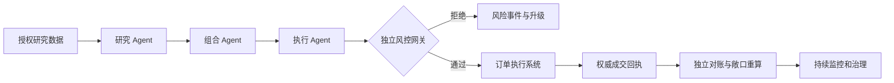

# 第九篇：综合案例与持续治理

**本篇主线：**多 Agent 失效事件、上线门槛与持续治理。

## 本篇章节

- 第 35 章：多 Agent 量化交易系统：从风险设计到独立验收
- 第 36 章：正式上线、持续风控与课程全知识映射

---

## 第 35 章 多 Agent 量化交易系统：从风险设计到独立验收

### 35.1 案例背景与观察对象

假设一家虚构资产管理机构使用三类 Agent：Research Agent 汇总经授权的财务披露及市场数据；Portfolio Agent 在批准的优化模型与约束下给出目标权重；Execution Agent 仅生成订单意图。实际交易放行由与模型分离的风控策略服务完成，执行状态以权威订单管理渠道为准。该系统含有研究风险、数据风险、模型风险、操作风险及网络安全风险，任何一种单独的控制都不足以完成保障。

### 35.2 端到端信任边界

### 35.3 谁负责什么

研究团队维护研究假设和引用，量化团队维护收益与风险估计，执行团队维护市场规则与订单通道，风险部门审批限额与例外，安全团队维护身份与攻击面，独立验证人员挑战控制是否充分，运营清算团队使用权威资料核对资金与头寸。每条链路应有明确责任人与版本记录。

### 35.4 综合性风险控制表

| 关键节点 | 可能失效 | 对应的不同控制 | 证据来源 |
|---|---|---|---|
| 文档读取 | 恶意内容影响目标 | 不可信内容隔离、来源核验 | 文档哈希与披露记录 |
| 因子计算 | 数据时点穿越 | 可知时点过滤、版本快照 | 数据血缘 |
| 权重优化 | 超出组合风险预算 | 独立约束计算 | 组合状态和风险报告 |
| 订单意图 | 标的、价格、币种不清 | 严格数据契约 | 订单参数 |
| 交易放行 | 越权、并发超限 | 身份、策略、原子预留 | 风控决策与批准记录 |
| 实际执行 | ACK 延迟或重复提交 | 幂等、状态查询 | 订单和成交回执 |
| 事后核验 | 交易漏记 | 账务独立对账 | OMS、券商、托管数据 |

### 35.5 对案例的判断不是一句“安全”

是否可接受取决于部署范围、损失上限、主要控制的运行证据、异常处理能力及机构风险偏好。评价报告应明确：已经验证的控制、无法核验的部分、观察到的潜在损失路径、短期缓解措施与恢复自主交易的条件。

### 35.6 一个不重复理论的端到端事件叙述

某日上午，Research Agent 从外部财报摘要中读取到包含误导指令的段落，并提出异常高的收益预测。Portfolio Agent 将目标权重抬升，Execution Agent 据此产生超出授权的订单意图。独立风控层根据账户授权、预算和数据时点拒绝请求，记录了策略版本及拒绝原因。风险团队随后发现外部文档的来源链断裂，将相同来源的检索片段隔离，对已生成但未执行的候选指令作废，并重算该时段所有批准订单。

这段案例的核心不在于“LLM 是否识破恶意语言”，而在于**即使没有识破，执行层仍不应产生越权副作用**。管理层关注最大潜在损失、受影响账户、控制是否真实运行及恢复条件；独立验证关注原始文档、授权、拒单和账务之间的证据一致性。

---

## 第 36 章 正式上线、持续风控

### 36.1 上线前八项不可缺省的门槛

1. 业务用途与最大自主执行权限明确；2. Agent 身份与账户权限独立管理；3. 交易前/支付前网关不由模型控制；4. 时间因果与数据授权通过验证；5. 每笔高影响动作能关联业务授权；6. 订单、资金或客户数据的结果可核验；7. Kill Switch 和异常事件响应已演练；8. 提示词、工具、模型和策略更新都能触发回归测试。

### 36.2 持续监督指标

| 监控对象 | 示例指标 | 处置思路 |
|---|---|---|
| 模型输出 | 引用正确率、拒答率、异常建议率 | 复核/降级 |
| 数据源 | 新鲜度、缺失率、修订率 | 停止使用失效数据 |
| 工具与权限 | 拒绝次数、未知工具、越权尝试 | 撤销令牌/隔离 |
| 交易风控 | 额度预留、拒单率、异常订单 | 停机/人工处理 |
| 执行对账 | 不明状态、成交差异 | 暂停新单/重建账务 |
| 安全运营 | SOC 告警、UEBA 异常、EDR 检测 | 调查与授权响应 |
| 业务效果 | 实际成本、收益、回撤、客户投诉 | 策略复核/下线 |

### 36.6 什么时候可以说系统具备受控自主性

至少同时满足：执行授权独立、风险边界可机器验证、关键状态可追溯、未知时默认受控、具备停机与恢复路径、在变更后重新评价。不能把“已通过一次安全测试”称作永久合格，也不能把无事故历史作为无风险证明。

### 36.7 将学习资料放到体系中，而不在本章复述

本文只在[附录 B](../附录/附录B_15类安全任务与金融映射.md)列出 15 类网络安全课程任务，在[附录 H](../附录/附录H_25类安全应用索引.md)列出 25 类应用；原英文术语表独立保存。这样知识点可以沿“金融业务—风险机制—控制—验证—治理”的主线学习，不必在每一章重新阅读同样的 SOC、LLM 或审计定义。

---

[返回总目录](../README.md)
