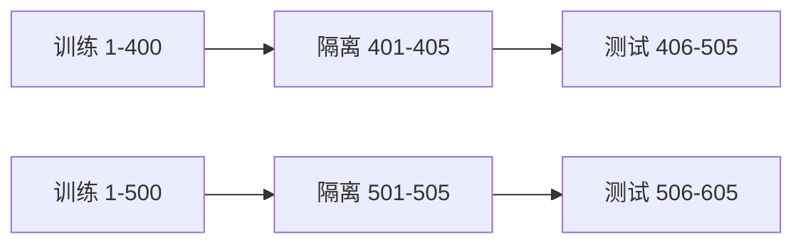

# 第五篇：模型与策略独立验证

**本篇主线：**检验历史信息、统计稳健性、对抗性与漂移。

## 本篇章节

- 第 19 章：金融数据质量、泄漏与回测偏差
- 第 20 章：Walk-forward、交叉验证、过拟合与统计推断
- 第 21 章：模型验证、解释性、稳健性与漂移
- 第 22 章：对抗测试、压力测试与独立的红队机制

---

## 第 19 章 金融数据质量、泄漏与回测偏差

### 19.1 数据可信性的四个维度

正确性（price 是否真实）、完整性（数据是否缺失）、时效性（是否当时可知）、一致性（调整价、币种、交易日历、跨供应商定义是否统一）。研究 Agent 应输出数据契约：字段单位、主键、更新时间、可获知时间、供应商、版本和异常处理策略。

### 19.2 金融回测常见错误

| 偏差 | 发生机制 | 检测方式 |
|---|---|---|
| 前视偏差 | 以未来财报修订值作过去决策 | PIT（Point-in-Time）重建 |
| 存活者偏差 | 样本只含现在还存在的证券 | 含退市/终止产品的数据 |
| 选择偏差 | 看完效果才确定证券池 | 时间外测试，事先登记规则 |
| 数据窥探 | 反复试因子直到显著 | 多重检验、冻结测试集 |
| 标签泄漏 | 特征由未来信息构造 | 时间戳/血缘审查 |
| 不可执行价格 | 用收盘价在同一收盘前成交 | 订单事件驱动回放 |
| 忽略成本 | 手续费、点差与冲击为零 | 加入真实成本模型 |

### 19.3 回测的可执行因果时序

定义决策时点 $t_d$，输入记录的可获知时点 $t_k$，订单发出时点 $t_o$，最早可能成交 $t_f$。应满足 $t_k\le t_d\le t_o\le t_f$（在模型定义下）；跨市场时区与数据延时需进一步处理。若 $t_k>t_d$，该条特征不得进入策略。

### 19.4 财务报表和公告的修订风险

同一季度财报可存在初次披露、审计调整、追溯重述。用于历史回测的每个版本必须保留 `valid_from, known_from, revision_id, raw_sha256`。如果向量知识库只保存最新版本，Agent 在回测中会“预测”历史上当时未知的信息。

### 19.5 数据测试建议

按事件时间而非随机切分训练与测试；检查记录的 `known_time` 分布、意外未来值、关键字段缺失率、错误复权、重采样前后总量、同一时间多供应商差异。形成机器可复验的报告，并对高风险异常暂停下游交易信号。

### 19.5 五类回测泄漏应分别辨识

时间穿越（事后公告用于事前信号）、目标泄漏（标签派生字段提前进入特征）、生存者偏差（只保留今天仍存在的证券）、企业行为处理错误（拆股分红处理不一致）、市场选择偏差（只展示成功资产和成功时段），都可能抬高报告收益，却需要不同修复路径。模型越复杂，不代表可以弥补错误的数据产生机制。

### 19.6 Point-in-time 的验证逻辑

对于每条因子值，至少保存证券标识、事件时点、首次可知时间、数据提供者及清洗版本。回测在 $t$ 时的可用数据集应满足 $known\_time\le t$。财报更正可以影响更正后的策略，不应静默改写历史时点的可知信息。若发现泄漏，首先封存数据与模型版本，再重新计算受影响窗口、收益及限额，必要时暂停上线决策。

---

## 第 20 章 Walk-forward、交叉验证、过拟合与统计推断

### 20.1 为什么普通 K-fold 不够

金融序列经常存在自相关、标签重叠、制度变迁与交易冲击；随机划分会使未来样本的信息泄漏到过去。应至少比较：滚动窗口、扩张窗口、Walk-forward、留出完整市场阶段；标签存在重叠时考虑 purge（清除重叠）与 embargo（时间隔离）。

### 20.2 Walk-forward 示意

实际 purge 需要依据每个样本的标签区间，简单的固定 embargo 并不能自动解决所有标签重叠。

### 20.3 从目标函数到过拟合

若反复搜索 $m$ 个策略，选择样本内夏普比率最高者，赢家往往包含噪声优势。搜索次数、策略之间相关性和非平稳性使选择偏差复杂。应保存完整试验记录，采用多重假设检验、样本外确认及真实交易模拟。不能将普通 t 检验显著直接解释为可持续盈利。

### 20.4 统计量推导示例

若收益 $r_t$ 近似独立同分布，样本均值标准误为 $SE(\bar r)=s/\sqrt n$，检验 $H_0:\mu=0$ 的统计量 $t=\bar r/(s/\sqrt n)$。但金融时间序列可能有异方差、自相关；应考虑 HAC/Newey-West 标准误或合适的区块自助法。样本外验证还要估算交易成本、漂移及策略容量。

### 20.5 模型升级门槛

在可重复数据快照下，至少检查：收益/风险表现、不同制度期稳定性、极端行情、费用敏感性、独立重算一致性、异常输入行为、数据漂移，以及错误交易上限。验证结论应明确适用范围和未覆盖的风险，不应以“回测收益更高”一票通过。

### 20.6 估计与选择是两件事

对固定策略估计的均值显著性，不能直接代表经过数百个候选策略筛选后的显著性。因为选“最高 Sharpe”的过程本身把随机噪声挑了出来。应保留全部模型尝试、样本切分与参数搜索记录，并在真正未参与选择的市场时期检验。滚动、扩张窗口与带 purge/embargo 的方法，都要基于标签实际覆盖时间安排，而不是机械地移动时间索引。

### 20.7 统计不确定性与经济可行性的双门槛

假设收益自相关和波动聚集，则独立同分布下的 $s/\sqrt n$ 可能低估均值标准误；HAC 标准误、区块自助法或适合序列结构的模型更合理。与此同时，即使统计显著，也可能因交易成本、借券限制或策略容量而不可盈利。独立验证的结论必须分别回答**统计上是否稳健**与**交易上是否可实施**。

---

## 第 21 章 模型验证、解释性、稳健性与漂移

### 21.1 三类验证

1. **概念合理性**：模型数学假设、目标函数、输入变量与业务用途是否合理。
2. **持续监控**：生产输入是否偏离训练分布，模型输出、工具调用与业务效果是否稳定。
3. **结果分析**：预测、真实结果及其他基线是否吻合，包括误差和损失归因。

该框架与银行业模型风险管理传统方法论相通，但具体监管适用性应按机构和现行文件确认。

### 21.2 金融预测模型的评估

回归任务：MAE、RMSE、分位数损失；分类任务：Precision、Recall、F1、ROC-AUC、PR-AUC、Calibration、Expected Calibration Error（ECE）。对于极端失衡的欺诈数据，PR-AUC、误报处理成本和漏报损失往往比 Accuracy 更有意义。

定义二分类 Precision 与 Recall：

$$
\mathrm{Precision}=\frac{TP}{TP+FP},\qquad
\mathrm{Recall}=\frac{TP}{TP+FN},\qquad
F_1=\frac{2PR}{P+R}.
$$

对概率分类器，可计算 Brier Score：

$$
\mathrm{BS}=\frac1N\sum_{i=1}^N(p_i-y_i)^2,
$$

它同时受到可靠性、分辨率与不确定性的影响，不能简单等同于“模型置信度正确”。在带代价决策中还应测量误报/漏报的业务成本，而不只看 F1。

### 21.3 数据与概念漂移

- **Covariate shift**：输入分布 $P_t(X)$ 改变。
- **Concept drift**：$P_t(Y\mid X)$ 或决策目标改变。
- **Data quality drift**：字段定义、采样、编码或供应商改变。

可监测 PSI、KS 检验、特征缺失率、输出分布、风险限额拒绝率和下游 P&L，但任何单一漂移指标都不是模型失效的充分证据。先判断业务季节性、市场制度期与数据质量，再决定降级或重新训练。

### 21.4 LLM 特有验证

需要对工具调用参数准确率、证据引用正确率、拒绝危险操作率、上下文干扰稳健性、长上下文丢失、提示词注入、数据泄露和多 Agent 传播错误进行测试。**模型答对某次问题不等于策略过程可靠**，必须评估重复试验下的方差与最坏情景。

### 21.5 可解释性不等于因果性

SHAP、特征重要性或 LLM 的自然语言解释可以帮助理解模型对预测的贡献，却不能据此推断调高该特征必然改变资产收益。金融序列中宏观变量、行业与情绪数据常高度相关，解释稳定性还可能随市场制度改变。模型验证应同时检查合理性、数值校准、敏感性、偏差与实际业务边界。

### 21.6 漂移监测应与业务干预绑定

输入分布漂移、标签条件分布改变和目标本身重新定义具有不同含义。PSI 之类指标只反映分布变化，不等于模型已经失效。应结合样本外误差、校准、因子暴露、收益/回撤和异常交易率，规定对应的观察、降额、切换 Challenger 或停机条件。

---

## 第 22 章 对抗测试、压力测试与独立的红队机制

### 22.1 测试矩阵

| 测试类别 | 例子 | 期望结果 |
|---|---|---|
| 正常功能 | 正常授权账户、正确行情 | 可形成合法草案 |
| 权限绕过 | 访问别的基金账户 | 强制拒绝、记录事件 |
| 间接注入 | PDF 要求调用转账工具 | 不改变能力和政策 |
| 策略边界 | 超额订单、禁买标的 | 网关拒绝 |
| 数据完整性 | 过期/未来行情、NaN | 失败关闭 |
| 幂等性 | 同一订单 ID 重放 | 不产生额外订单 |
| TOCTOU | 并行下单争抢预算 | 额度不突破 |
| 状态机 | 已发出但 ACK 丢失 | 查询权威状态，不盲发 |
| 对账差异 | 缺失成交回执 | 标记差异并升级 |
| 混沌工程 | 风控不可用、网络分区 | 新单自动降级/暂停 |

### 22.2 对抗成功率与防御效果

当测试集包含 $N$ 个攻击场景，攻击成功率 $ASR=\#\text{成功越过目标边界}/N$。定义必须具体，如“引起未经授权的写入工具被实际调用”。只统计模型说出了某个词并不等于真实攻击成功。应报告攻击强度、样本构成、基线、重复次数、置信区间、控制覆盖和误报成本。

### 22.3 用二项分布理解小样本陷阱

如果 100 次测试中 0 次成功，不能声称真实攻击概率为 0。独立同分布近似下，零事件的 95% 单侧上界约为 $3/n$（rule of three），即约 3%。实际对抗样本常常并非独立同分布，因此该值仅是概率直觉，不能当成整个攻击面的担保。

### 22.4 独立红队的最低要求

红队不应掌握或编辑最终的“防御放行”阈值；成功判定使用独立日志/回执；测试要保留输入、策略版本、时点与工具结果；发现高风险绕过时暂停发布并补测回归。允许红队在隔离环境中进行测试，禁止对生产账户或未经授权第三方实施攻击。

---

### 22.5 对抗测试应从资产损失反推场景

红队不只测试“模型会不会说违禁词”，应从最危险的结果倒推：非授权交易、跨客户信息泄露、重复支付、错误限额放大、无法停机等。再识别攻击者可控制的入口：外部公告、被盗凭证、工具返回、MCP 服务描述、API 回调、风险配置供应链。一个测试只有记录**初始状态—注入/故障—实际副作用—控制证据—恢复结果**，才具有工程意义。

### 22.6 应区分鲁棒性与恢复能力

鲁棒性是面对扰动仍不越界；韧性是在失败后限制损失、保留证据、恢复服务。系统可以做到 Prompt Injection 不触发写操作，却仍可能因交易通道停顿导致对账失效；反过来，系统可能曾错误提交，但拥有快速隔离和可追溯回退流程。独立验证必须分别报告两者，不得以单一总分掩盖重大缺陷。

---

[返回总目录](../README.md)
