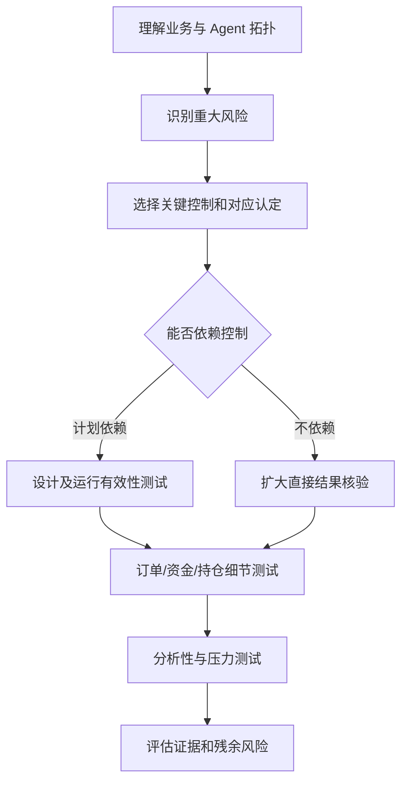

# 第六篇：借鉴审计的控制验证方法

**本篇主线：**风险导向的计划、控制评价、结果核验与证据。

## 本篇章节

- 第 23 章：独立性、职业怀疑、重要性与内部控制
- 第 24 章：风险评估、验证计划与进一步程序
- 第 25 章：控制测试、实质性程序、细节测试与分析程序
- 第 26 章：证据充分性、抽样、缺陷定级与持续验证

---

## 第 23 章 独立性、职业怀疑、重要性与内部控制

### 23.1 “审计思维”与“CPA 审计”是两回事

本文保留审计理论的分析价值，但目标是帮助**金融 Agent 风控与验证人员**建立可靠控制。内部控制是业务管理必须持续运行的机制；独立验证是检查该机制是否可靠；内部审计是另一项有组织独立性要求的评价活动。

### 23.2 独立性分四层

- **组织独立性**：风险验证人员不对自己批准的模型作最终独立结论。
- **技术独立性**：风控规则不是由策略 Agent 生成后立即自行修改；执行密钥与风控配置分域。
- **数据独立性**：验证取数与交易效果不完全依赖被评估 Agent 的自述。
- **方法独立性**：独立重算和异构验证，避免完全共享模型缺陷。

独立性不是绝对二元特征，而是需记录威胁、补偿措施和可接受剩余风险。

### 23.3 重要性与风险导向

传统审计“重要性”可以启发风险优先级；金融 Agent 中应将资产规模、单次可执行金额、业务不可逆性、客户数量、监管后果、敏感度纳入实质性判断。但不应把财报审计重要性阈值机械套用于金融订单限额。**零容忍控制**可能适用于未经授权资金转移，哪怕金额很小。

### 23.4 COSO 内控思路的技术映射

| COSO 要素 | 金融 Agent 实现 |
|---|---|
| 控制环境 | 责任与风险偏好、文化、权限分离 |
| 风险评估 | Agent 资产、攻击面、错误交易场景 |
| 控制活动 | 风控网关、审批、幂等、对账 |
| 信息与沟通 | 标准事件、告警、升级、报告 |
| 监督活动 | 漂移监控、控制复测、缺陷整改 |

### 23.5 借鉴审计思维，但不照搬财报审计目标

内部控制的五要素可作为检查清单：控制环境（职责和风险文化）、风险评估（识别资金与客户损失场景）、控制活动（策略网关和审批）、信息沟通（有效告警与证据）、监督（独立复核与持续整改）。这里的目标是保障金融 Agent 的安全运行，不是对财务报表整体发表审计意见。

### 23.6 两种独立性须明确区分

**审计/验证独立性**指评价人员不对自身设计和实施的控制无条件背书；**系统控制独立性**指风控策略和执行权限在技术上不受被约束的 Agent 任意修改。前者解决评价可信度，后者减少实际越权机会。即使组织中的验证人员独立，若生产系统允许 Agent 修改其风险限额，仍无法阻止资金事故。

### 23.7 “重要性”不能只用金额衡量

数据泄露、市场操纵风险、客户适当性错误、监管申报遗漏即便当前经济损失很小，也可能构成重大事件。项目可以建立定量阈值与定性红线并列的风险矩阵。**审计风险模型不应机械当作交易亏损概率公式**，二者的对象与概率假设不同。

---

## 第 24 章 风险评估、验证计划与进一步程序

### 24.1 验证计划结构

明确：对象/版本/部署环境、业务范围、风险边界、控制目录、证据来源、职责、日程、样本设计、异常升级、验收标准与产出报告。先画清数据/工具边界，再决定验证程序，避免拿一套通用 Prompt 测试代替业务风险评估。

### 24.2 风险识别 → 程序响应

在审计基础理论中，**风险评估程序**用于了解系统和识别高风险点；**进一步程序**包括控制测试和实质性程序；实质性程序又分细节测试和实质性分析程序。对于本书的工程实践：风险评估用于设计测试计划，控制测试验证防线，实质性验证独立核对真实业务结果。

### 24.3 认定转译

| 传统认定 | Agent 风控问题 |
|---|---|
| 发生/存在 | 订单是否真实发出、成交是否存在 |
| 完整性 | 所有调用/成交是否被采集 |
| 准确性 | 数量、价格、费用、持仓计算是否正确 |
| 截止 | 批准、策略、数据是否在正确时点生效 |
| 权利与义务 | 是否有权交易该账户/数据 |
| 分类/列报 | 风险、交易与异常是否被正确呈现 |

### 24.4 风险、控制、证据矩阵

所有重大场景写成统一记录：`risk_id → scenario → business loss → control objective → preventive/detective control → owner → test procedure → evidence → exception decision → remediation`。只有风险清单而没有独立证据来源，无法支撑可验证的安全结论。

### 24.5 从风险陈述写到进一步验证程序

首先了解 Agent 的业务流程，形成风险场景清单；随后确定“完整性、准确性、授权、发生、截止、分类”在该流程的含义；再识别哪些控制能够预防或及时发现偏差；最后按风险级别安排控制运行评价与对真实结果的独立核对。二者并非彼此替代：风控网关设计合理，不说明历史订单没有漏记；对账没有差异，也不能推断将来无法越权。

### 24.6 控制依赖策略与直接验证

如果关键控制不可依赖，则应扩大对订单、资金、持仓、权限变动的直接核验范围，同时要求先行修复和风险降级；扩大抽样无法补偿一个可以随时产生无限资金损失的缺陷。评价报告应写清未测试范围、总体构成、数据缺口与剩余风险，不以“未观察到问题”代替“安全得到证明”。

---

## 第 25 章 控制测试、实质性程序、细节测试与分析程序

### 25.1 控制测试（Test of Controls）

目标是判断**控制本身是否设计合理、已实施且持续运行**。例：伪造 12000 元订单，在 10000 元限额下是否总被拒绝；在并发争抢时总敞口是否仍受限；切换策略版本后是否仍遵守先审批后生效。证据包括请求、政策快照、拒绝事件和规则版本。

### 25.2 细节测试（Test of Details）

目标是核对**实际交易或报告项目是否正确**。例：抽取某日 20 笔纸面订单，逐笔对照身份、审批、预留、发送、回执、成交、费用与仓位；其中一笔事后发现无批准记录，即使控制测试全部通过，也要作为真实交易偏差调查。

### 25.3 实质性分析程序

通过独立计算总成交名义额、风险预算消耗、组合波动、异常换手率、成交成本、账户净现金流，形成有预期值的合理性检查。它并非所有“数据分析”的同义词：需要事先明确预期、容忍偏差、数据可靠性与调查程序。高风险错误交易可能无法靠汇总平均值发现，仍需细节核验。

### 25.4 综合性方案与实质性方案

- **综合性方案**：认为关键控制可测试且可依赖，结合控制测试和必要的实质性验证。
- **实质性方案**：不依赖关键控制，侧重扩大直接结果核验；但对高频不可逆交易，仅做事后细节测试无法替代必须实施的交易前控制。

**重要区别**：这两种表述来自审计程序组织方法，不能作为金融工程中“可以没有事前风控”的依据。

### 25.5 审计方法工具箱

访谈、观察、检查、穿行测试、重新执行、独立重算、函证/第三方核验、抽样、全量规则扫描、异常聚类、权限穿透、故障注入、事件回放、对抗测试、证据保全。检查配置只能证明某时刻的存在，不能代替整段期间的运行有效性。

### 25.5 同一风险的四类评价为什么不同

以“Agent 可能发出未经批准的大额订单”为例：**设计评价**检查网关是否包含审批条件；**控制测试**观察在设定时段和异常状态下，审批规则是否确实阻断；**细节核验**抽取已发订单，核对每笔对应的实际批准、参数、回执；**实质性分析**独立计算交易集中度、总敞口和高频拆单模式。四者证据对象不同，不能把几条拒单截图当成所有历史订单合规的证明。

### 25.6 综合性方案与实质性方案的区别

综合性方案在控制可以依赖的前提下，结合控制有效性与结果核验；实质性方案则主要直接检查业务事实，适用于控制不能被可靠依赖的场景。但对于高不可逆性的资金动作，不能因为直接核对更仔细，就容忍生产长期缺少关键预防控制。内控评价和经济结果核验之间是互补关系，而不是相互替代。

---

## 第 26 章 证据充分性、抽样、缺陷定级与持续验证

### 26.1 证据的四个属性

**相关性**：与控制目标直接对应；**可靠性**：来自相对独立可信的来源；**完整性**：覆盖关键事件和时段；**可复验性**：另一位验证人员可得到一致结论。Agent 的自述/解释是调查线索，不是证明自己执行正确的外部证据。

### 26.2 样本抽取及其局限

事件级测试可以使用总体分层：按账户、市场、金额、策略版本、时间段、超限/临界值和异常情景分层，优先覆盖高影响业务。全量日志查询虽然覆盖更多记录，但仍可能受日志丢失、控制被绕过或数据源遗漏影响，因此**全量分析不等于完整保证**。

### 26.3 用比例置信区间评估缺陷

抽取 $n$ 笔独立同分布记录，发现 $k$ 笔缺陷，样本缺陷率为 $\hat p=k/n$。可使用 Wilson 区间或 Clopper–Pearson 区间评价不确定性；但如果为风险导向的非随机样本，不能把区间解释为总体无偏估计。必须分别报告抽样方式、总体大小、时间窗和覆盖缺口。

### 26.4 缺陷分级

建议采用“真实或潜在最大损失、是否已越过授权边界、可利用性、持续时间、影响客户数、替代控制、发现与恢复能力”等维度。**重复支付与未授权下单**应有独立的升级机制，而不由平均风控评分来掩盖。严重缺陷应支持暂停上线/降低自主级别、整改和独立复测。

### 26.5 持续控制验证

将高价值控制变成 CI/CD 回归测试：每次模型、工具、提示词、风险规则、数据源更新，运行模拟超限、越权、重复、过期、注入、工具不可用及对账用例。监控生产偏差并定期回放代表性真实事件（适当脱敏）。审计底稿与系统变更记录共同支撑持续改进。

---

### 26.5 证据质量高于材料数量

Agent 输出的摘要、自己生成的风险分数、编排器的成功标志都容易受到同一系统偏差影响。独立券商回执、受保护的权限配置、不可篡改日志与独立计算结果往往更有说服力。但“外部系统数据”也需要验证接口完整性、时间差和总体覆盖。没有可追溯来源的截图或会议口头说明，不能用于支撑强结论。

### 26.6 抽样的前提是总体完整

对订单随机抽样之前，先核实“所有真实执行订单”是否都进入抽样框；否则漏记的大额订单永远抽不到。对于少量高金额、高权限或不可逆事件，优先全量检查；常规低风险事件可采用统计或判断抽样，并披露选择方法与局限。控制偏差率的样本结论不能直接等同于资金错报率，两者总体与测量单位不同。

### 26.7 缺陷定级须观察潜在损失路径

严重性由可导致的最大合理损失、客户与市场影响、可利用性、范围以及补偿控制决定。即使一次尝试被拦住，如果可以通过未受控接口绕行，仍可能是重大设计缺陷。整改应区分短期隔离、结构性修复、独立复核、再上线决定和后续有效性观察。

---

[返回总目录](../README.md)
